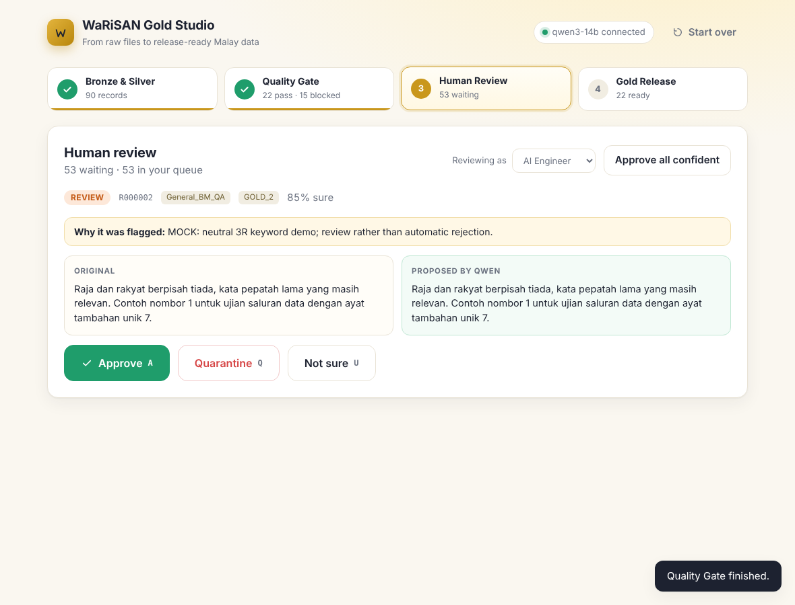
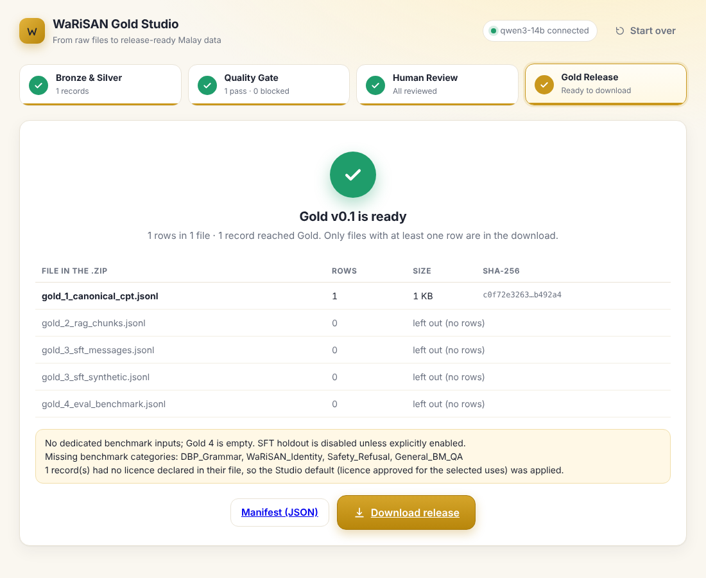
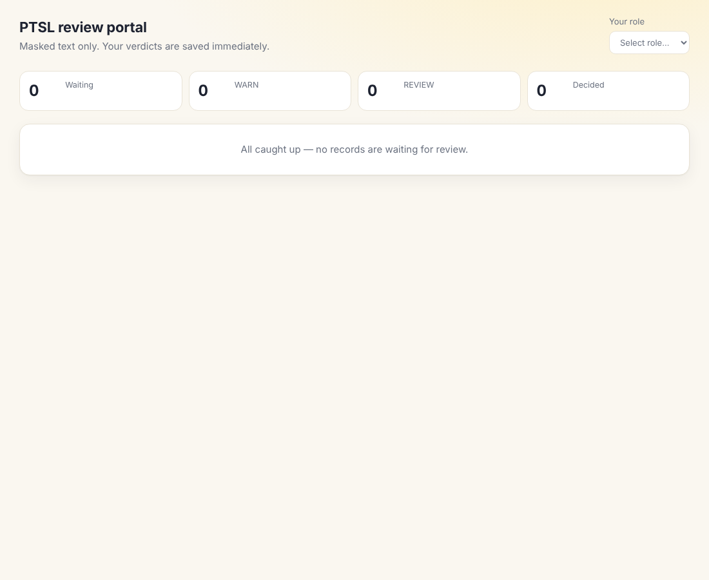
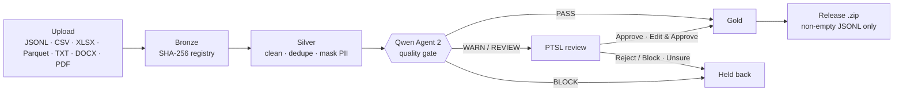

<div align="center">


**A persistent curation workspace that turns raw Malay files into validated, versioned Gold datasets.**
Qwen checks every record. Humans (PTSL reviewers) decide what is flagged. Only clean data is released.


-003B57?logo=sqlite&logoColor=white)


[Quick start](#-quick-start) · [Pipeline](#-how-it-works) · [Reviewer portal](#-ptsl-reviewer-portal) · [Configuration](#-configuration) · [Docs](#-documentation)

</div>

---

## ✨ Highlights

- **Four-step guided flow** — Bronze & Silver → Quality Gate → Human Review → Gold Release, with live progress.
- **Qwen quality gate** — every record gets PASS / WARN / REVIEW / BLOCK with a reason and confidence.
- **Isolated PTSL reviewer portal** — masked text only; no upload, no settings, no export. Verdicts are saved instantly.
- **Nothing is lost on restart** — batches, Bronze SHA-256 hashes, Silver records, Qwen results and review decisions live in SQLite.
- **No more empty exports** — sensible licence / allowed-use defaults, per-file row counts before download, and a plain reason for every exclusion. Only non-empty `.jsonl` files are zipped.
- **Privacy first** — PII masked before inference; raw uploaded bytes are never stored.

## 🖼 Screenshots

| Human review | Gold release | PTSL portal |
|---|---|---|
|  |  |  |

*Screenshots use fictional demo data and the bundled mock Qwen.*

## 🔄 How it works



| Tier | File | Purpose |
|---|---|---|
| Gold 1 | `gold_1_canonical_cpt.jsonl` | Canonical continued-pretraining text |
| Gold 2 | `gold_2_rag_chunks.jsonl` | RAG chunks (300–600 tokens) |
| Gold 3 | `gold_3_sft_messages.jsonl` / `gold_3_sft_synthetic.jsonl` | SFT conversations |
| Gold 4 | `gold_4_eval_benchmark.jsonl` | Dedicated evaluation benchmark |

## 🚀 Quick start

```bash
git clone https://github.com/Akramtaha98/watan-gold-studio.git
cd watan-gold-studio
python3 -m venv .venv && source .venv/bin/activate
pip install -r requirements.txt

# Web UI + API (serves the prebuilt frontend from web/dist)
QWEN_BASE_URL=http://127.0.0.1:8000/v1 QWEN_MODEL=qwen3-14b STUDIO_PORT=8503 python studio_api.py
```

Open <http://127.0.0.1:8503>. No GPU handy? Run `python mock_qwen.py` in another terminal and point `QWEN_BASE_URL` at it. The mock is scripted and only for demos.

Rebuild the frontend (Node 18+):

```bash
cd web && npm install && npm run build
```

Run the tests:

```bash
pip install -r requirements-dev.txt
python -m pytest -q tests
```

## 🧑‍⚖️ PTSL reviewer portal

Open **`/review`** (or `/?mode=ptsl`). Reviewers see only WARN/REVIEW records with masked text, Qwen's suggestion, flags and category/language tags.

| Role | Verdicts |
|---|---|
| `Linguist` · `Domain_SME` · `Project_Lead` | Approve · Edit & Approve · Reject / Block · Unsure |

- Each verdict is written to SQLite immediately with a UTC timestamp, and the main dashboard's counters update live.
- DBP-error records need Linguist or Project_Lead; project facts need Project_Lead.
- Set `PTSL_REVIEW_TOKEN` to require a token (sent as `X-Review-Token`). For a public tunnel, run a second process with `STUDIO_PORTAL_ONLY=1` so only the portal is reachable.

## ⚙️ Configuration

| Variable | Purpose |
|---|---|
| `QWEN_BASE_URL` / `QWEN_MODEL` / `QWEN_API_KEY` | vLLM endpoint and model (default `http://127.0.0.1:8000/v1`) |
| `STUDIO_PORT` | API port (default `8503`) |
| `STUDIO_DB` | SQLite path (default `studio_state.db`) |
| `STUDIO_ACCESS_TOKEN` | Guards the admin API. Required, ≥32 chars, when `STUDIO_ENV=production` |
| `PTSL_REVIEW_TOKEN` | Token for the reviewer portal (≥32 chars in production) |
| `STUDIO_PORTAL_ONLY=1` | Serve only `/review` and `/api/ptsl/*` |

Copy `.env.example` to your private secret store. **Never commit `.env`, databases, releases, raw corpora or logs.**

## 🗂 Repository layout

```
studio_api.py        FastAPI backend for the React UI
studio_db.py         SQLite persistence (WAL)
studio_portal.py     Isolated PTSL reviewer API
watan_gold_studio.py Core pipeline, schemas, governance and Streamlit app
silver.py            Silver-layer cleaning, dedupe and routing
ptsl_api.py          External portal API and webhooks
web/                 React 18 + Vite frontend (web/dist is prebuilt)
tests/               pytest suite (inference is mocked)
docs/                Guides, reference and assets
```

## 📚 Documentation

- [Web UI, persistence and portal](docs/WEB_UI.md)
- [Pipeline alignment](docs/PIPELINE_ALIGNMENT.md)
- [Full reference (contracts, safeguards, production)](docs/REFERENCE.md)
- [External portal integration](docs/portal-integration.md)
- [Large-data and adversarial testing](docs/HARD_TESTING.md)

## 🤝 Contributing

Issues and pull requests are welcome. See [CONTRIBUTING.md](CONTRIBUTING.md). Run `python -m pytest -q tests` before opening a PR.

## ⚠️ Scope

Qwen scores are model estimates, not a DBP authority. The Studio does not verify source licences; the default licence is a curator declaration. `examples/` holds fictional fixtures only.
